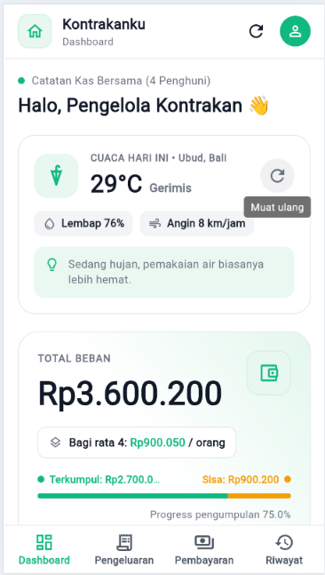
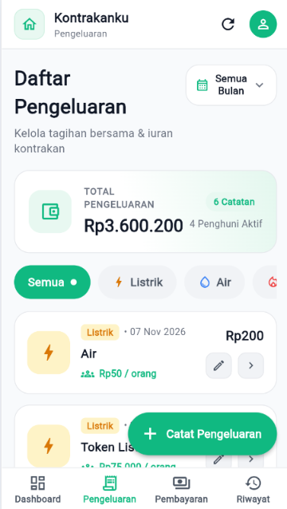
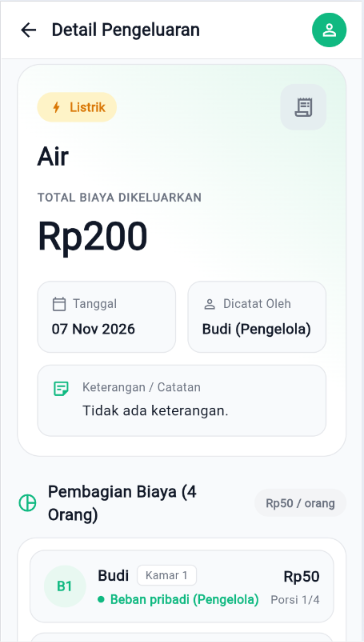
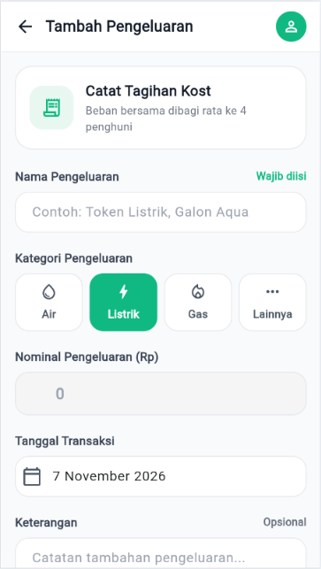
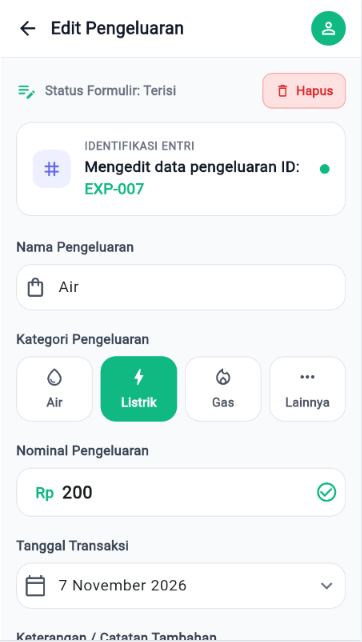
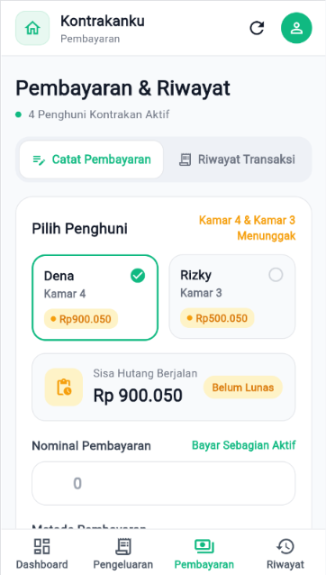
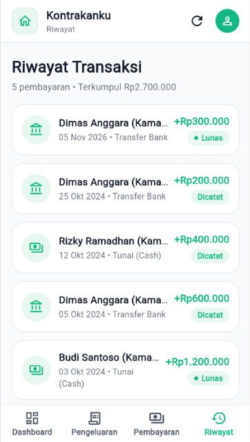
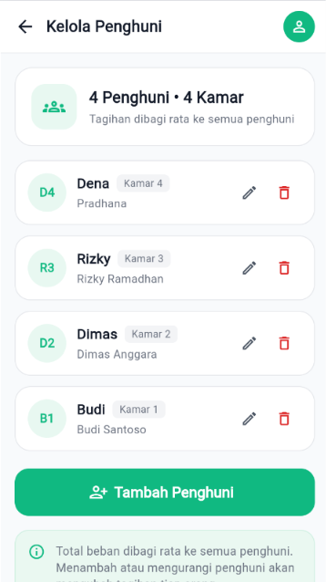
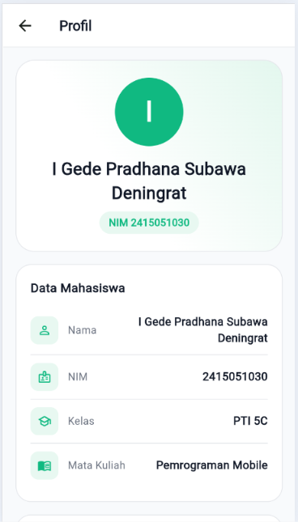

# Kontrakanku

Aplikasi mobile Flutter untuk **mencatat pengeluaran kontrakan, membagi biaya secara merata ke semua penghuni, dan mencatat pembayaran masing-masing penghuni** (termasuk pembayaran sebagian). Dirancang untuk satu pengelola, sehingga **tidak memerlukan login**.

Project ini dibuat untuk Ujian Tengah Semester mata kuliah **Pemrograman Mobile**.

## Identitas

| | |
|---|---|
| Nama | I Gede Pradhana Subawa Deningrat |
| NIM | 2415051030 |
| Kelas | PTI 5C |
| Tema | Pencatatan pengeluaran dan pembayaran kontrakan |
| APK | [Download UTS_2415051030_IGedePradhanaSubawaDeningrat.apk](build\app\outputs\flutter-apk\UTS_2415051030_IGedePradhanaSubawaDeningrat.apk) |


## Fitur

- **Dashboard**: ringkasan total beban, dana terkumpul, progres pengumpulan, iuran tiap penghuni, pengeluaran terbaru, dan info cuaca.
- **Daftar pengeluaran**: filter kategori (Listrik, Air, Gas, Lainnya) dan filter bulan, tampil 1 kolom (layar sempit) atau 2 kolom (layar lebar).
- **Detail pengeluaran**: rincian biaya dan pembagian per penghuni (data dikirim dari daftar).
- **CRUD pengeluaran**: tambah, ubah, hapus (dengan dialog konfirmasi), lengkap dengan validasi form.
- **Pembayaran**: catat pembayaran penghuni, mendukung pembayaran sebagian, simulasi sisa tagihan, dan validasi nominal.
- **Riwayat pembayaran** dan label Lunas/Dicatat.
- **Kelola penghuni**: tambah, ubah, hapus penghuni dan nomor kamar.
- **Refresh data**: tombol refresh dan tarik-untuk-memuat-ulang.
- **Profil/About**: data mahasiswa dan informasi aplikasi.
- **Loading, error, dan empty state** pada layar yang memuat data.

## Tech Stack

- Flutter dan Dart
- State management: Provider (`ChangeNotifier`)
- Backend/database: Supabase (PostgreSQL)
- REST API: Open-Meteo (HTTP GET dengan paket `http`)

## REST API

**Open-Meteo Forecast API** (publik, gratis, tanpa API key)

```
GET https://api.open-meteo.com/v1/forecast
    ?latitude=...&longitude=...
    &current=temperature_2m,relative_humidity_2m,wind_speed_10m,weather_code
```

Response JSON dikonversi menjadi model `Weather` dan ditampilkan sebagai kartu cuaca di Dashboard (dengan state loading, error, dan kosong). Fungsinya berbeda dari database: API dipakai untuk informasi tambahan, sedangkan data pengeluaran dan pembayaran disimpan di Supabase.

## Backend dan Database

Supabase (PostgreSQL) dengan 3 tabel. Skema lengkap ada di [`supabase/schema.sql`](supabase/schema.sql) dan data awal di [`supabase/seed.sql`](supabase/seed.sql).

| Tabel | Kolom |
|---|---|
| `tenants` | id (PK), name, full_name, room (unik) |
| `expenses` | id (PK), title, category, amount, expense_date, note, created_at |
| `payments` | id (PK), tenant_id (FK ke tenants), amount, method, paid_at, note, created_at |

Operasi CRUD penuh dilakukan pada `expenses`; `payments` dan `tenants` mendukung tambah, baca, ubah/hapus sesuai fitur.

## Arsitektur

```
lib/
├── main.dart
├── models/          Expense, Tenant, Payment, Weather
├── services/        akses Supabase dan REST API
├── repositories/    penghubung service dan provider
├── providers/       ChangeNotifier: Expense, Payment, Weather
├── screens/         halaman aplikasi
├── widgets/         komponen UI yang dipakai ulang
├── theme/           warna dan gaya kategori
└── utils/           format, validasi input, breakpoint, refresh, konfigurasi
```

Alur data:

```
Screen/Widget  →  Provider  →  Repository  →  Service  →  Supabase / REST API
```

Screen tidak melakukan pemanggilan HTTP atau query database secara langsung.

Layar utama: Dashboard, Daftar Pengeluaran, Detail Pengeluaran, Tambah Pengeluaran, Edit Pengeluaran, Pembayaran, Riwayat, Kelola Penghuni, dan Profil.

Layout responsif memakai `LayoutBuilder`: **compact** (di bawah 800 px) memakai bottom navigation dan daftar 1 kolom, sedangkan **wide** memakai NavigationRail dan daftar 2 kolom.

## Screenshot

| Dashboard | Daftar Pengeluaran | Detail |
|---|---|---|
|  |  |  |

| Tambah | Edit | Pembayaran |
|---|---|---|
|  |  |  |

| Riwayat | Kelola Penghuni | Profil |
|---|---|---|
|  |  |  |

**Layout responsif**

| Compact | Wide |
|---|---|
|  |  |

**Data REST API dan database**

| Cuaca (REST API) | Tabel Supabase |
|---|---|
|  |  |


## Cara Menjalankan

Prasyarat: Flutter SDK dan akun Supabase untuk menggunakan database sendiri.

1. Ambil project dan dependensi:

   ```bash
   git clone https://github.com/GedePradhana/UTS_2415051030_I-Gede-Pradhana-Subawa-Deningrat.git
   cd UTS_2415051030_I-Gede-Pradhana-Subawa-Deningrat
   flutter pub get
   ```

2. Siapkan database: buka **SQL Editor** di project Supabase, lalu jalankan isi `supabase/schema.sql` dan `supabase/seed.sql` untuk membuat tabel, kebijakan akses, dan data awal.

3. Siapkan konfigurasi Supabase: buat file `env.json` di folder utama project, sejajar dengan `pubspec.yaml`, lalu isi dengan Project URL dan Publishable Key milik project Supabase Anda.

   ```json
   {
     "SUPABASE_URL": "https://PROJECT_ID.supabase.co",
     "SUPABASE_KEY": "sb_publishable_..."
   }
   ```

   File `env.json` tidak disertakan dalam repository karena sudah dimasukkan ke `.gitignore`.

4. Jalankan aplikasi:

   ```bash
   flutter run --dart-define-from-file=env.json
   ```

   Untuk menguji tampilan melalui Chrome:

   ```bash
   flutter run -d chrome --dart-define-from-file=env.json
   ```

5. Tes dan build APK:

   Jalankan pengujian:

   ```bash
   flutter test
   ```

   Build APK release:

   ```bash
   flutter build apk --release --dart-define-from-file=env.json
   ```

   Hasil APK berada di `build/app/outputs/flutter-apk/app-release.apk`.

## Catatan

- Aplikasi dirancang tanpa login untuk satu pengelola, sehingga aturan akses database terbuka untuk peran `anon`. Konfigurasi ini hanya untuk keperluan tugas dan tidak untuk data sungguhan.
- Total beban dibagi rata ke jumlah penghuni saat ini, dengan pembulatan ke bawah. Mengubah jumlah penghuni mengubah tagihan semua orang.
- Menghapus penghuni ikut menghapus riwayat pembayarannya.